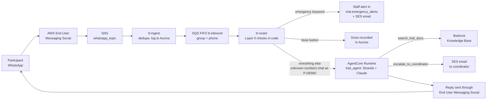
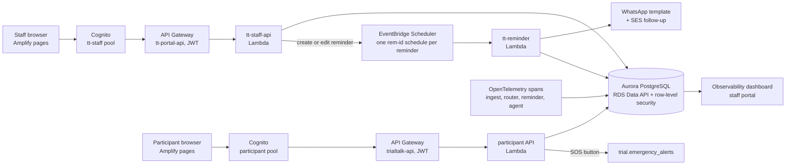

# TrialTalk

TrialTalk is a clinical-trial participant companion. Participants talk to an Amazon Bedrock AgentCore agent (Claude on Bedrock, with knowledge-base retrieval for protocol questions) over WhatsApp, sent and received through AWS End User Messaging Social. Study staff run a web portal for participants, reminders, requests and emergency alerts. Amazon SES carries coordinator escalations, emergency alerts and missed-dose follow-ups. Every message path is traced with OpenTelemetry (spans, token usage, estimated cost, config-change markers), and the staff portal has an Observability dashboard that reads those traces from Aurora.

Active branch: `main`. The staff and participant pages are hosted on AWS Amplify (branch `main`, `amplify.yml`) at https://main.dqzri9vvxpyky.amplifyapp.com (`/staff/` and `/participant/`). Everything below is synthetic data; no real participant or PHI is in the repo.

## Try it live

The system is deployed on AWS. The step-by-step guide for judges, with the staff and participant URLs, the WhatsApp number and a 10-minute walkthrough (enroll yourself, get a dose reminder on WhatsApp, raise an emergency, use the participant website), is in [`docs/judges.md`](docs/judges.md).

- Staff portal: https://main.dqzri9vvxpyky.amplifyapp.com/staff/
- Participant website: https://main.dqzri9vvxpyky.amplifyapp.com/participant/
- WhatsApp: +1 609 642 3667 (or https://wa.me/16096423667)

Logins are shared with the judges separately; they are not in this repository.

## Run it locally in 5 minutes (no AWS needed)

The local dev server runs the real Lambda handlers, the real schema and the real row-level security against a throwaway PostgreSQL. Only the AWS clients (Data API, WhatsApp, SES, Scheduler, Cognito, AgentCore) are replaced by fakes in `coordinator-backend/tests/local_env.py`.

Prerequisites:
- Python 3.12+ (the Lambdas target 3.12; the local steps below were also run on 3.14).
- A local PostgreSQL install with `initdb` and `pg_ctl` on disk. You only need its `bin` folder, the server is started and deleted by the dev server. The docs target PostgreSQL 16; the quickstart below was also run against 18. Homebrew: `brew install postgresql@16` (bin: `/opt/homebrew/opt/postgresql@16/bin`). Debian/Ubuntu: `apt install postgresql-16` (bin: `/usr/lib/postgresql/16/bin`, not verified here).
- macOS or Linux. Windows is untested (the backend README's conda recipe mentions `Library/bin`).

```bash
git clone https://github.com/PratikBhangale/Continuum-ai.git
cd Continuum-ai

python3 -m venv .venv
.venv/bin/pip install "psycopg[binary]" boto3

TT_PG_BIN=/opt/homebrew/opt/postgresql@16/bin LC_ALL=en_US.UTF-8 \
  .venv/bin/python coordinator-backend/devserver/server.py --seed-telemetry
```

On Linux use `LC_ALL=C.UTF-8` instead of `en_US.UTF-8`. The `postgresql@16` path is an example: any modern PostgreSQL `bin` directory works (also verified against 18).

Then open **http://127.0.0.1:8787/staff**:

1. You land on the sign-in page with a demo staff account already filled in (Jamie Fox, a PI at both sites; local password for every account is `TrialTalk-Demo-2026!`). Click **Sign in**.
2. Click **Observability** in the sidebar: about 7 days of synthetic traces (`whatsapp.ingest` -> `whatsapp.route` -> `agent.call` -> `agent.invoke` -> `tool.*`), request/error/latency charts, token counts, estimated cost, a trace waterfall and a mid-week agent-config change marker. **Token usage** shows token totals.
3. Also worth a look: **Emergency alerts** (acknowledge and resolve), **Participants** (dose reminders, send now, timeline, adherence, communications), **Requests** (a "Needs attention" list of flagged symptoms, missed doses and failed messages from the last 7 days, then participant questions with one-click replies), **Team**. The participant portal is at http://127.0.0.1:8787/participant (sign in with `+1 732 555 0142`, Maria Lopez, same password); its orange adverse-event button raises an alert that appears on the staff side within a few seconds, and its chat talks to a local echo agent.

Stop with Ctrl+C; the database is deleted. `LC_ALL` sets a UTF-8 locale for the throwaway database: `en_US.UTF-8` on macOS; on Linux use `LC_ALL=C.UTF-8` (minimal images and containers often lack `en_US.UTF-8`, and `initdb` fails without it), or drop the variable if your default locale is already UTF-8. Any modern PostgreSQL bin dir works (the docs target 16; this was also run against 18): point `TT_PG_BIN` at yours. Anything the server would have sent to AWS (WhatsApp messages, SES emails, schedules) is recorded by the fakes and readable at http://127.0.0.1:8787/dev/outbox. Full runbook, including `--real-agent` and the Conda-based setup: [`coordinator-backend/README.md`](coordinator-backend/README.md#testing).

## Where AWS Communication Developer Services are used at runtime

| Service | What it does here | Where |
|---|---|---|
| AWS End User Messaging Social (WhatsApp), send | Free-text and interactive-button replies, approved-template messages (dose/visit reminders), login codes | `triggers/lambdas/common/wa.py`: `send_text`, `send_buttons`, `send_template` (`socialmessaging.send_whatsapp_message`). Used by `triggers/lambdas/router/handler.py` (replies) and `triggers/lambdas/reminder/handler.py` (reminders). Same call for the portals: `coordinator-backend/lambdas/common/whatsapp.py` (`send_template`, used for the participant login code in `auth_triggers/participant_auth.py`). Legacy single-Lambda path: `triggers/whatsapp/handler.py` |
| AWS End User Messaging Social, inbound | WhatsApp messages and delivery receipts arrive as events on an SNS topic | `triggers/lambdas/ingest/handler.py` (`tt-ingest`, parses with `wa.parse_sns`, dedupes, queues to SQS FIFO); legacy direct handler `triggers/whatsapp/handler.py` (`incoming_messages`) |
| Amazon SES (`sesv2.send_email`) | Escalation email to the coordinator when the agent flags a symptom | `agent/trial_agent/tools.py`: `escalate_to_coordinator` |
| Amazon SES | Emergency-keyword alert email, sent by Layer 0 before any model runs | `triggers/lambdas/router/handler.py`: `emergency` |
| Amazon SES | Missed-dose follow-up escalation to the coordinator | `triggers/lambdas/reminder/handler.py`: `follow_up` |
| Amazon SES | Participant SOS button email to site staff | `coordinator-backend/lambdas/participant_api/handler.py` (`_alert_team`, called from the SOS and chat emergency paths) |

### See them running

- **Staff portal:** open a participant, then **Records** > **Communications**. Every WhatsApp message is listed with its delivery status (sent, delivered, read or failed), as reported back by AWS End User Messaging Social, together with the alert emails the router and reminder Lambdas send. **Emergency alerts** shows the alert raised by an emergency keyword on WhatsApp.
- **CloudWatch logs (us-east-1):** `/aws/lambda/tt-ingest` shows each inbound WhatsApp event and delivery receipt; `/aws/lambda/tt-router` the replies and Layer 0 actions; `/aws/lambda/tt-reminder` the template sends. Every SES send, including the agent's escalation emails, shows in the Amazon SES console under sending statistics.
- **Locally:** `http://127.0.0.1:8787/dev/outbox` lists every WhatsApp message and email the code tried to send.

Not every call can fire without AWS and a verified WhatsApp number, which is why the local server uses fakes. The calls above are exercised with those fakes by the test suites.

## Architecture at a glance

```
agent/                 AgentCore trial agent (agent/agentcore = CDK/config, agent/trial_agent = code)
db/                    Aurora schema, roles/RLS, seed data, DB tests
coordinator-frontend/  Staff and participant web pages (plain HTML/JS/CSS, no build step)
coordinator-backend/   Staff and participant API Lambdas, deploy scripts, tests, local dev server
triggers/              Event-driven Lambdas (ingest, router, reminder, reconcile, whatsapp) and their deploy script
docs/                  Design notes (docs/superpowers/specs: OpenTelemetry observability design)
infra-requirements-otel.txt   Pinned OpenTelemetry SDK bundled into the Lambda zips
amplify.yml            Amplify build for coordinator-frontend
```

**A WhatsApp message**



**Portals, reminders and observability**




The WhatsApp cutover is done: `tt-ingest` forwards every inbound message to `tt-router`, and the older single-Lambda WhatsApp handler is unsubscribed from the topic (rollback steps in [`triggers/README.md`](triggers/README.md#switching-on-cutover)). Source of truth for the deployed system is what is in AWS (account `180026596905`, us-east-1, resources named `tt-*`), not a CDK app. `agent/trial_agent`, `triggers/` and `coordinator-backend/lambdas` match the deployed code. The original design doc (`TrialTalk build plan.pdf`) is kept out of git.

## Deploying to AWS

Deploy is script-driven with an AWS profile; nothing here is needed for the local quickstart. The scripts name the resources of our own account, so a different account needs the values below changed first.

**Prerequisites (one time, in the console)**

- An AWS account in `us-east-1`, the AWS CLI signed in (`aws login`), Python 3.12 with `pip install boto3 "botocore[crt]"`, and Node.js for the AgentCore CLI.
- Amazon Bedrock model access for the Claude model named in `agent/trial_agent/root_agent.yaml`.
- A WhatsApp Business Account linked in AWS End User Messaging Social, with its event destination set to an SNS topic named `whatsapp_topic`, and the WhatsApp templates approved (listed in the backend README).
- An Amazon SES verified sender identity (and a verified recipient while the account is in the SES sandbox).
- An S3 bucket holding the participant guide `agent/trial_agent/trial_docs.md`; its bucket and key are set under `trial_docs` in `root_agent.yaml`.
- An Aurora PostgreSQL Serverless v2 cluster named `trialtalk` with the Data API enabled.

**Values to change for another account:** `ACCOUNT`, `CLUSTER_ARN`, the secret ARNs, `AGENT_RUNTIME_ARN`, `ORIGINATION_PHONE_NUMBER_ID`, `WABA_ID`, `COORDINATOR_EMAIL` and `SENDER_EMAIL` at the top of `triggers/infra/deploy.py`; `FIRST_STAFF`, `PARTICIPANT_POOL_ID` and `CORS_ORIGINS` in `coordinator-backend/infra/deploy_portal.py`; the `email` and `trial_docs` settings in `agent/trial_agent/root_agent.yaml`.

**Steps, in this order**

1. **Database.** Run the numbered SQL files in `db/` in order with `db/run_sql.py` (`01` to `08`; `03` is synthetic seed data and `04` is the SQL tests), using the cluster's master secret. Replace the `CHANGE_ME` passwords from `02_roles_rls.sql` and store each login in Secrets Manager as `trialtalk/db/<login>`. Details: [`db/README.md`](db/README.md).
2. **Agent.** From `agent/`, run `agentcore deploy` (AgentCore Runtime via the AgentCore CLI) and note the runtime ARN for `AGENT_RUNTIME_ARN`. Details: [`agent/README.md`](agent/README.md).
3. **Trigger Lambdas.** `python triggers/infra/deploy.py --profile <profile>` creates `tt-ingest`, `tt-router`, `tt-reminder`, `tt-reconcile`, the SNS subscription, the SQS FIFO queue and the schedules. Forwarding to the router stays off until you run it once with `--cutover` (after removing any older handler subscribed to the topic). Details: [`triggers/README.md`](triggers/README.md).
4. **Staff API.** `python coordinator-backend/infra/deploy_portal.py --profile <profile>` creates the `tt-staff` Cognito pool, `tt-staff-api` and the HTTP API `tt-portal-api`. The participant API (`coordinator-backend/lambdas/participant_api`) is not deployed by these scripts; the local server runs it for evaluation. Details: [`coordinator-backend/README.md`](coordinator-backend/README.md#deploy).
5. **Portal pages.** Connect an AWS Amplify app to this repository's `main` branch; it builds `coordinator-frontend` with `amplify.yml`. Add the Amplify address to `CORS_ORIGINS` in `deploy_portal.py` and re-run step 4. Details: [`coordinator-frontend/README.md`](coordinator-frontend/README.md).
6. **Check it works.** Message the WhatsApp number from a phone; the reply comes from `tt-router` and the agent. The first staff user and the WhatsApp templates are console steps, listed in the backend README.

## Tests

Run from the repo root unless noted. A venv with `pytest`, `psycopg[binary]`, `boto3`, `PyYAML`, `tzdata` and `opentelemetry-sdk==1.45.1` covers all three suites; the agent suite also needs `strands-agents` and `bedrock-agentcore[strands-agents]`.

```bash
# coordinator backend: unit tests, plus integration tests (real handlers + schema + RLS) when TT_PG_BIN is set
AWS_DEFAULT_REGION=us-east-1 TT_PG_BIN=<postgres bin dir> LC_ALL=en_US.UTF-8 python -m pytest coordinator-backend/tests

# triggers (boto3 is faked by conftest)
cd triggers && python -m pytest tests/

# agent (offline: the Strands agent and AWS clients are stubbed)
cd agent/trial_agent && AWS_DEFAULT_REGION=us-east-1 python -m pytest test_tracing.py -v
```

Without `TT_PG_BIN` the backend integration tests are skipped. The backend tests need a default AWS region set (any value) because the handlers create boto3 clients at import. The database SQL tests in `db/` run against a real database; see [`db/README.md`](db/README.md).

## License

MIT, see [`LICENSE`](LICENSE).
